<p align="center">
  
</p>

<p align="center">
  <a href="https://kevin-manzini.tech"><b>Portfolio</b></a> &nbsp;·&nbsp;
  <a href="mailto:kevinasanda99@gmail.com"><b>kevinasanda99@gmail.com</b></a> &nbsp;·&nbsp;
  <a href="https://github.com/KevinAsanda?tab=repositories"><b>Repositories</b></a>
</p>

I'm a software development student who builds full-stack web platforms, mobile apps and data tools. Think of this profile as the demo tape: .NET 8 and TypeScript systems, relational databases with strict access controls, native mobile companions and revenue-assurance analytics.

```text
▶  NOW PLAYING
   Full-stack systems · mobile apps · cloud & relational data engineering

   1:42 ━━━━━━━━●─────────────────────── ∞
```

## Liner notes

I like projects where every part has to play in time: an API that feeds a real interface, a database that keeps the state, a dataset that answers a question worth asking.

On the application side, I connect backends, frontends and persistent storage across web and mobile. On the data and tooling side, I build systems around real local workflows — from scholar transport and workshop operations to telecom revenue assurance.

## Tracklist

### Side A · Flagship Systems

**01 &nbsp;[Malume](https://github.com/KevinAsanda/Malume)**

South African scholar transport and hybrid e-hailing platform combining monthly seat subscriptions, corridor-constrained ad-hoc rides, B2B2C fleet and school management, offline-first QR/PIN child handover and a staged milestone escrow ledger.

<sub><code>.NET 8</code> · <code>C#</code> · <code>Blazor WebAssembly</code> · <code>SQL Server</code> · <code>Kotlin</code> · <code>React Native</code></sub>

**02 &nbsp;[ANM — Automotive Service Management](https://github.com/KevinAsanda/ANM)** &nbsp;·&nbsp; [Live Demo](https://anm-customer-portal.onrender.com)

Workshop operations platform pairing a public customer booking and token-based repair tracker with an authenticated staff portal for interactive job cards, parts inventory, shift logs and transactional invoicing.

<sub><code>TypeScript</code> · <code>React</code> · <code>Node.js</code> · <code>Express</code> · <code>PostgreSQL</code> · <code>Supabase RLS</code></sub>

**03 &nbsp;[BMS — Butchery Management System](https://github.com/KevinAsanda/bms)**

Full-stack Progressive Web App built for Simon Family Farm Butchery with touch-optimised POS checkout, automatic stock deductions, POPIA-compliant AES-256-GCM customer encryption and daily cash-up analytics.

<sub><code>React</code> · <code>Node.js</code> · <code>Express</code> · <code>Prisma</code> · <code>PostgreSQL</code> · <code>PWA</code></sub>

**04 &nbsp;[P4P — Prepped 4 Prep](https://github.com/KevinAsanda/P4P)** &nbsp;·&nbsp; [Live Demo](https://p4p-customer.onrender.com)

Dual-application school stationery e-commerce and warehouse operations monorepo connecting a public parent storefront and AI-assisted list matcher with an isolated staff portal for barcode-verified packing and fulfilment.

<sub><code>TypeScript</code> · <code>Next.js</code> · <code>Prisma</code> · <code>PostgreSQL</code> · <code>Supabase</code> · <code>pnpm Monorepo</code></sub>

### Side B · Data, Mobile & Tools

**05 &nbsp;[Ghost SIM Hunter](https://github.com/KevinAsanda/ghost-sim-hunter)**

Three-layer telecom revenue assurance and RAN spatial analytics engine that reconciles daily CDRs against rollover bundles, corporate pools and zero-rated APNs to surface unbilled active SIMs for forensic case review.

<sub><code>Python</code> · <code>Starlette</code> · <code>SQLite</code> · <code>Revenue Assurance</code> · <code>Anomaly Scoring</code></sub>

**06 &nbsp;[Charades — Mzansi Charades](https://github.com/KevinAsanda/Charades)** &nbsp;·&nbsp; [Demo APK](https://github.com/KevinAsanda/Charades/releases/latest)

Native Android party game celebrating South African pop culture, kwaito, local slang and nostalgic moments, built with offline Room storage, Firebase sync and server-side Gemini deck capabilities.

<sub><code>Kotlin</code> · <code>Jetpack Compose</code> · <code>Room</code> · <code>Firebase</code> · <code>Android</code></sub>

**07 &nbsp;[UniMarket v2](https://github.com/KevinAsanda/UniMarket_v2)** &nbsp;·&nbsp; [Live Demo](https://unimarket-frontend.onrender.com)

Closed peer-to-peer campus marketplace for MUT students featuring OCR student-card verification, live face matching, moderated listings and atomic PostgreSQL RPC checkout.

<sub><code>React</code> · <code>Vite</code> · <code>Supabase</code> · <code>PostgreSQL</code> · <code>Tesseract.js</code> · <code>face-api.js</code></sub>

**08 &nbsp;[MetaTrader 5 Python Trading Suite](https://github.com/KevinAsanda/Trading-Bot-V1)**

Algorithmic FX trading engine with multi-symbol portfolio execution, vectorized Pandas backtesting, grid parameter optimization and a FastAPI mission control dashboard.

<sub><code>Python</code> · <code>FastAPI</code> · <code>Pandas</code> · <code>SQLite</code> · <code>MetaTrader 5</code></sub>

## The band

| Part | Played by |
|---|---|
| **Lead** · frontend & web | TypeScript · Next.js · React · Blazor WebAssembly |
| **Backline** · backend & APIs | .NET 8 / C# · Node.js / Express |
| **Rhythm section** · databases | PostgreSQL · Supabase · SQL Server · Prisma · Entity Framework Core |
| **On tour** · mobile | Kotlin (Jetpack Compose) · React Native |
| **Synth & studio gear** · data & tools | Python · Git · GitHub Actions · Docker |

## Flip the record

More of my work is on the [repositories page](https://github.com/KevinAsanda?tab=repositories). Full engineering case studies, architecture diagrams and walkthroughs for all featured projects live on my [portfolio](https://kevin-manzini.tech).

<details>
<summary><b>Hidden track</b></summary>

<br>

When I'm not coding, I'm probably listening to music. Requests are welcome through the contact page on my portfolio.

</details>

<br>

<p align="center">
  ▁ ▂ ▃ ▅ ▇ ▅ ▃ ▂ ▁<br>
  <sub>In constant development. A little code. A lot of curiosity.<br>Made with code. Inspired by music.</sub>
</p>
