<p align="center">
  
</p>

<p align="center">
  <a href="https://kevin-manzini.tech"><b>Portfolio</b></a> &nbsp;·&nbsp;
  <a href="https://github.com/KevinAsanda?tab=repositories"><b>Repositories</b></a>
</p>

I'm a software development student who builds web applications and digs into data. Think of this profile as the demo tape: .NET apps, relational databases, and Jupyter notebooks on customer churn and healthcare access.

```text
▶  NOW PLAYING
   Full-stack development · cloud computing · the endless rabbit holes of modern JavaScript

   1:42 ━━━━━━━━●─────────────────────── ∞
```

## Liner notes

I like projects where every part has to play in time: an API that feeds a real interface, a database that keeps the state, a dataset that answers a question worth asking.

On the application side, I connect backends, frontends and persistent storage. On the data side, I look at customers, communities and who can actually reach the services they need.

## Tracklist

### Side A · Applications

**01 &nbsp;[Full-Stack To-Do App](https://github.com/KevinAsanda/TodoApi)**

A task manager split into a REST API and a responsive Blazor WebAssembly frontend, with SQL Server for storage. Create, view, update and delete tasks. The backend and frontend live in separate projects.

<sub><code>Full-stack web</code> · <code>C#</code> · <code>ASP.NET Core</code> · <code>Blazor WebAssembly</code> · <code>Entity Framework Core</code> · <code>SQL Server</code></sub>

### Side B · Data

**02 &nbsp;[Customer Churn Model](https://github.com/KevinAsanda/CustomerChurnModel)**

A notebook working through the Telco Customer Churn dataset.

<sub><code>Data</code> · <code>Jupyter notebook</code></sub>

**03 &nbsp;[Geographic Disparity of Healthcare Access](https://github.com/KevinAsanda/Geographic-Disparity-of-Healthcare-Access)**

A healthcare data project that pairs a notebook with geographic data and datasets on hospital beds, medical scheme coverage, health professionals and diabetes prevalence.

<sub><code>Data</code> · <code>Jupyter notebook</code> · <code>Geographic data</code></sub>

## The band

| Part | Played by |
|---|---|
| **Lead** · application development | C# · ASP.NET Core Web API · Blazor WebAssembly |
| **Rhythm section** · databases | SQL Server · Entity Framework Core |
| **Studio gear** · tools | Git · GitHub · Visual Studio · Jupyter |
| **Guest spots** | JavaScript · TypeScript · React · Node.js · Python |

## Flip the record

More of my work is on the [repositories page](https://github.com/KevinAsanda?tab=repositories). Longer write-ups, including Prepped 4 Prep and ANM Workshop, live on my [portfolio](https://kevin-manzini.tech).

<details>
<summary><b>Hidden track</b></summary>

<br>

When I'm not coding, I'm probably listening to music. Requests are welcome through the contact page on my portfolio.

</details>

<br>

<p align="center">
  ▁ ▂ ▃ ▅ ▇ ▅ ▃ ▂ ▁<br>
  <sub>In constant development. A little code. A lot of curiosity.<br>Made with code. Inspired by music.</sub>
</p>
